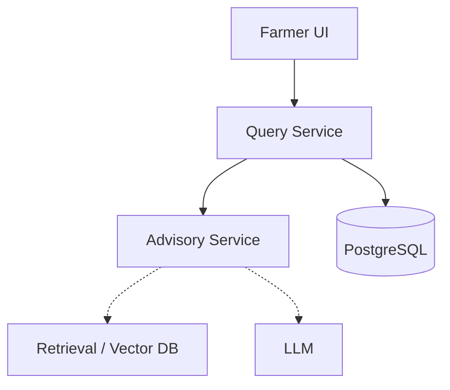

# Architecture

## Request Flow

Farmer UI → Query Service → Advisory Service → (Future) Retrieval and External Data Providers

1. **Farmer UI**: Submits a query.
2. **Query Service**: Handles the user-facing API, persists the query and history in PostgreSQL, and forwards the request to the Advisory Service.
3. **Advisory Service**: Responsible for orchestrating the LLM and RAG logic to generate a contextual answer.

## PostgreSQL and pgvector

PostgreSQL is used as the primary database for the system. It stores user profiles, query history, and system responses.
The `pgvector` extension will be used for similarity search and vector retrieval once the embedding model is integrated (Phase 2).

## Diagram

